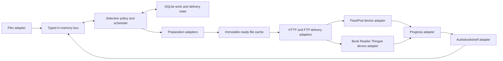

# One host service for music, podcasts and books

Solution-space decision and execution handoff, October 19, 2026. Status: proposed architecture, grounded in the existing PearlPod publisher and Book Reader Thingee client. This is not an implementation or deployment claim. The user requested multiple adapters and an in-memory bus. This replaces reader-triggered audiobook conversion as the target design.

## Frame

**Problem:** prepare selected media on the NAS before a listener's device connects, then deliver compatible offline files while preserving each upstream account, item, ordering and listening position.

**Binding constraints:** preserve working PearlPod music, Book Reader Thingee's offline playback and ABS identity/progress; keep upstream credentials on their appropriate hosts/clients; leave NAS originals intact; retain stock upstream servers; prevent lengthy preparation from blocking device sync. A unified service must not imply that every device already supports every media type.

**Working story:** one Python service owns selection reconciliation, preparation and delivery planning. Source, preparation, device, delivery and progress adapters communicate through a small typed in-memory bus. Durable desired state and jobs survive independently of that bus. Media bytes stream directly from completed files.

**Success signal:** with both devices off, an ABS selection change and a Plex playlist change produce ready files; a restart loses neither work nor progress; each device receives its supported representation, resumes interrupted transfer, remains independently usable offline, and an unchanged selection causes zero encodes and zero unnecessary media replacements.

**Decision criteria:** reuse measured working code; prepare before device contact; keep adaptation boundaries explicit; preserve account permissions and source timelines; avoid upstream forks; minimize always-running components; isolate slow/failing work; allow another source or device without changing the core.

## Candidates

| Option | Level and assumed frame | Does it solve the problem? | Main cost and second-order effect | Disposition |
|---|---|---|---|---|
| A: add ABS branches to the current syncer | Local optimum; current publisher is the application | Can prewarm books, but source, format, device and transport assumptions remain coupled | Fastest patch; the existing shared processing lock can serialize music behind a long book, and more media types multiply conditionals | Reject as the final structure; wrap existing behavior during migration |
| B: one service with adapters and an in-memory bus | Redesign; selection, preparation and delivery are independent concerns | Yes, with durable intent/reconciliation underneath transient notifications | Requires explicit contracts and failure handling; avoids a broker while making components independently testable | Selected |
| C: separate music/book/feed services and an external broker | Redesign; each pipeline should deploy independently | Yes, including multi-host scale | Adds deployment, broker, schemas and operational failure modes without a current multi-host requirement | Defer; revisit only if workers must run on different hosts |
| D: thin lazy transcoding proxy | Reframe; obtaining bytes is the whole problem | Serves media but fails the requirement that preparation finish before a device connects | Less scheduling code; leaves users waiting and couples battery/network lifetime to conversion | Reject |

These are different frames: A trusts the existing application boundary, B changes that boundary, C tests a distributed deployment boundary, and D tests whether scheduling is needed at all. The user workflow and observed reader waiting invalidate D; code inspection of the global lock weakens A. B depends most on correct restart reconstruction and adapter isolation, so those are first execution gates.

## Selected structure

One host application process, its persistent data directory, bounded FFmpeg/lftp subprocesses, and a standard reverse-proxy front end for pass-through. No external message broker. The proxy is an infrastructure component of the same deployment, not another media preparation service. SQLite belongs on a local NAS filesystem/bind mount, never an SMB/NFS client mount.

The diagram is the control/dependency map. Audio files and HTTP response bodies do not travel over the bus. ABS pass-through goes directly through the proxy to ABS; it does not wait for an event handler or transcoding worker.

### Adapter contracts

| Boundary | Initial implementations | Responsibility | Must not own |
|---|---|---|---|
| Source | Plex, Audiobookshelf | Snapshot selections and metadata; observe change hints; reconcile; resolve allowed source files; check upstream permissions | Device filenames, FFmpeg arguments, transport or new listening-progress authority |
| Preparation | Existing music MP3 profile; audiobook M4B profile; spoken-podcast profile | Produce and verify one compatible rendition and its cover/chapter/lyric assets | Accounts, selection order, device sockets |
| Device | PearlPod, Book Reader Thingee | Advertise capabilities; choose eligible profiles; map readable layout/manifests; report inventory/receipts and supported progress | Plex/ABS API details or conversion implementation |
| Delivery | Existing PearlPod FTP push; HTTP range pull | Capacity checks, immutable revision pinning, resume, completion receipts, cancellation | Transcoding on demand or choosing the listening queue |
| Progress | ABS-native pass-through; future PearlPod long-form bridge | Preserve source/account/item/episode mapping; durably forward explicitly supported progress operations | A replacement ABS bookmarks database or music progress semantics invented from track changes |
| Infrastructure | Filesystem cache, SQLite store, credential references, reverse proxy, diagnostics | Persist work; store ready objects; bound resources; serve status and route traffic | Source-specific selection rules |

Use explicit Python interfaces/dataclasses and an explicit adapter registry. No runtime plugin discovery, generic workflow language or adapters that import each other's concrete implementation. Device capabilities and preparation profiles are separate: neither `source == Plex` nor `device == PearlPod` should imply a media type or codec in the core.

Minimal shared contracts are `MediaRef(source_instance, item, optional_episode)`, `SelectionSnapshot(account_ref, selection, revision, ordered_media_refs)`, `Rendition(media_ref, source_revision, profile_revision, object_hash, bytes, duration, timeline_origin)`, `DeviceCapabilities(codecs, containers, chapters, durable_resume, progress, transports)`, and `DeliveryPlan(device, selection_revision, pinned_renditions, capacity, receipts)`. A rendition has source timeline origin zero; conversions must not concatenate or trim source time without an explicit mapping. Adapter-specific metadata remains namespaced rather than adding Plex/ABS fields to every core object.

Retain legacy `/health`, `/status` and `/sync` behavior while exposing versioned capabilities and prepared-object contracts. Keep the reader's existing book-cache response shape compatible; extend episode support with an explicit episode ID and capability/version negotiation, not an ambiguous item ID or an episode disguised as a book. New device manifest fields are versioned; existing consumers keep their current contract until their adapters and firmware accept the next version.

### Bus and recovery semantics

- Commands have a single owner: `ReconcileSelection`, `EnsureRendition`, `PlanDelivery`, `CancelDelivery` and supported `SubmitProgress`. Events describe committed facts: `SelectionChanged`, `RenditionReady`, `PreparationFailed`, `DeliveryCompleted` and `ProgressAcknowledged`.
- Event fan-out uses a bounded queue per subscriber. A shared queue with competing consumers is appropriate for a worker pool, not for broadcasting a fact to several adapters. No synchronous chain of callbacks performs network or media work.
- Initial bounds: 256 pending notifications per subscriber, two preparation subprocess slots globally, at most one long-form encode, one active delivery per device and at most two device deliveries globally. These are conservative starting settings, measured on the actual NAS before raising them. Reserve the other preparation slot for short music jobs; a large book cannot monopolize all preparation capacity.
- SQLite records configured selections, desired revisions, source fingerprints, rendition jobs, publication references, device delivery plans/receipts and any host-accepted progress awaiting upstream acknowledgment. It stores no audio blobs and does not replace either upstream database. Credential material remains outside event payloads/logs; runtime records use credential references.
- Persist the obligation before returning acceptance or emitting its notification. The bus wakes workers; periodic scheduling scans and startup reconciliation also find queued/dirty rows. There is no need to persist and replay every telemetry event or build a general event store.
- Processing is idempotent and may be repeated after interruption. Unique job keys prevent duplicate publication, not an unsupported promise of exactly-once execution. A job key combines stable source identity, source bytes/fingerprint, relevant metadata/chapters/cover and the versioned profile. Selection reordering and device identity are not media-cache invalidators.
- Startup registers subscribers before starting producers, recovers unfinished jobs/dirty plans, checks published files, then reconciles upstream selections. Keep the last ready publication during upstream failure. A filesystem rename followed by a crash before the SQLite ready update yields an orphan to validate/adopt or reclaim, never an automatically trusted publication.
- Queue pressure coalesces selection hints by selection ID and progress-display updates by job ID. Critical work remains represented in durable rows and is retried by scheduling scans; it cannot be silently dropped. Transient telemetry can be replaced by its latest value.
- One component owns each mutable state projection. Per-selection revisions reject stale/out-of-order hints; source reconciliation is authoritative. Blocking filesystem/library code runs in bounded workers, FFmpeg/lftp run as bounded child processes, and thread-originated notifications enter the event loop through its thread-safe scheduling entry point.
- Adapter failures are caught and classified inside supervised component tasks. Expected source/auth/encode failures must not escape an all-service task group and cancel healthy adapters. Fatal core/store failures report unavailable readiness; they never claim accepted work that could not be committed. Shutdown stops intake, terminates or drains bounded workers, persists unfinished work and leaves last ready files usable.

Python's bounded asyncio queues provide the required in-process backpressure; they are not thread-safe. Python task groups cancel sibling tasks when an unhandled child exception occurs, which is why adapter supervision boundaries matter. See [Python queue documentation](https://docs.python.org/3.12/library/asyncio-queue.html) and [task-group documentation](https://docs.python.org/3.12/library/asyncio-task.html#task-groups). SQLite WAL requires same-host access and does not work over a network filesystem: [SQLite WAL documentation](https://sqlite.org/wal.html).

### Source and media identity

Keep separate identities for source instance, source item, episode, account, source revision, rendition and device delivery. Connection URLs are transport aliases, not a reason to reset a book's place. Do not merge items from different upstream instances because names or paths happen to match. The same artifact can serve two authorized listeners while their progress, selection and device receipts remain independent.

Plex initially retains selected audio playlists and the existing host-only token flow. ABS supports configured collections, playlists and podcast selections through the appropriate account context. Authenticated ABS change events are hints for prompt refresh; startup/reconnect and periodic reconciliation recover missed events. Use the existing 60-second reconciliation interval initially. A failed request or lost permission is not an empty selection.

For unattended ABS watching, use a separate native ABS API key associated with each relevant account, stored in a restricted host runtime secret file. The inspected ABS 2.37.1 API-key controller lets an administrator create a key for a specified user, and SocketAuthority supports that key type. This preserves private-playlist visibility without copying the device's rotating refresh token or requiring a logged-in device. Provision keys through stock ABS; do not extract secrets from its database. Read runtime secrets once and reuse the authorized session rather than repeatedly invoking 1Password per operation. Revocation/expiry produces an adapter-specific needs-auth state, not an empty queue or a service restart.

NAS media is mounted read-only with explicit allowed-root translation and symlink containment checks. Source changes during preparation invalidate that job. Stable source/prepared fingerprints avoid rehashing/re-encoding unchanged NAS media every minute. Operators change a profile version deliberately when its recipe changes; provenance records the encoder binary/version actually used.

### Preparation and cache

Reuse PearlPod's existing source/prepared fingerprint memoization, content-addressed host objects, temporary-file workflow, artwork handling, previous-publication protection and cache budget. Refactor these boundaries around reusable functions, keeping the current music outputs stable under golden checks. Its music recipe and chapter stripping are not the audiobook implementation.

Each changed source/profile gets one fixed encoding recipe. Copy compatible media when the selected profile permits it; otherwise one FFmpeg invocation performs downmix/resample/encode and metadata/chapter/cover mapping. Probe the output, verify intended duration and chapter/cover representation, recheck the source, compute the output hash and atomically publish. These integrity checks are not another transcode. No automatic gain-search loop or rejection solely because a lossy floating-point peak modestly exceeds full scale. Keep exhaustive decoder/peak diagnostics and listening comparisons as acceptance tools rather than unconditional multi-pass production work.

Profiles are selected by verified capability intersection, not assigned permanently by product name. Two devices that can use the same profile share its prepared object. Before adding a second long-form encode for PearlPod, compare a common spoken-MP3 profile with canonical chapter/cover manifests against the reader's existing M4B profile. Both decode MP3, but that alone does not prove seek, chapter, metadata or resume compatibility. Keep the current reader M4B fixture for the first migration; adopt a shared profile only after those checks and the quality comparison. Preparing multiple genuinely different required profiles is legitimate; preparing the same profile again for another device is not.

Initial profile decisions: preserve the working PearlPod MP3 profile and stream-copy rules; use a separately versioned mono AAC-LC M4B speech profile for reader books/podcasts, with the existing 24 kHz/32 kbps candidate as the first acceptance fixture. Pin the known installed FFmpeg 7 pair for NAS tests. Encoding-method quality and final bitrate require the already-planned representative listening check; `fast` AAC below 64 kbps is not assumed quality-equivalent to the default encoder. The standard `twoloop` coder is the quality baseline for that check. This profile choice does not block implementing adapters and ready-only delivery, but audible-quality signoff blocks calling the profile final. See [FFmpeg 7 AAC encoder options](https://raw.githubusercontent.com/FFmpeg/FFmpeg/n7.0.2/doc/encoders.texi).

Publish complete objects per item; an incomplete new selection item must not hide an already-ready book. A device delivery plan pins object revisions before it starts. Cache eviction protects active preparation scratch space, active delivery revisions, current/previous publications, and explicit pins, and only reclaims unreferenced objects under a budget. Removing a selection stops future eligibility; it is not authority to delete the listener's active or unacknowledged offline media.

Host transfer leases and local-device playback pins are different. An offline device does not permanently pin every host artifact: completed receipts release transfer leases, abandoned transfer leases have a resumable grace period, and an evicted host object can be prepared again if needed. Local current/unplayed files remain protected by the device-retention policy. Always keep the metadata needed to explain or reconstruct an evicted rendition.

### Selection, queueing and podcast defaults

| Media/workflow | Initial explicit behavior |
|---|---|
| Music | Preserve playlist order, repeat membership, readable Artist/Album/track paths, covers, lyrics and relative M3U8 files. Reordering changes publication metadata, not prepared audio. |
| Simple-mode books | Host prepares the selected queue ahead; device retains the current book plus one ready successor. Advance on completion under the existing playback policy. Preserve a valid current book if no successor is ready. |
| Normal-mode books | Make the configured selection available for browsing/jumping within its declared card budget. Pin current/in-progress media; show items pending for preparation or space instead of silently dropping them. |
| Podcasts | ABS owns feed subscription, feed refresh and original episode download. The service observes available episodes and prepares a configured device selection; it does not independently subscribe to the same feed. |
| Podcast starting policy | Per selected show, initially choose up to three newest unplayed available episodes and order those oldest-first. Once selected for offline use, hold an episode until played or explicitly removed; refill an opened slot from eligible recent episodes. Explicit backfill can select older episodes. This avoids replacing an unheard episode whenever a newer one arrives. |
| Podcast retention | Protect current/unplayed delivered episodes. Played episodes become cleanup candidates after upstream progress acknowledgment, replacement availability and a seven-day grace period. Enforce the card budget without deleting active media; insufficient space is visible, and manual removal is explicit. These are configurable defaults, not new ABS completion semantics. |

Device retention uses persisted plans/receipts and supported inventory feedback. The host cannot infer that a device deleted a file or finished an episode from the passage of time. Initial legacy PearlPod delivery has no long-form completion signal, so it must not use playback-based automatic deletion until that capability exists.

### Device capabilities and the full media matrix

| Device and media | What is reusable now | Required before claiming full support |
|---|---|---|
| PearlPod music | Current MP3 files, UI, FTP delivery, ordinary card layout | Unified-service regression acceptance |
| PearlPod podcasts/books | MP3 decoding and ordinary offline files | Durable within-track position, stable item/episode identity on card, progress reporting, chapter/long-form navigation and suitable queue UI; verify resume after power loss |
| Book Reader Thingee books | Native M4B/MP3, chapter/timeline model, ABS account/progress, buffered HTTP downloader, simple/normal modes | Ready-only service cutover, both-book transfer/resume and silent boundary checks |
| Book Reader Thingee podcasts | Existing episode identity/download/progress code paths | Actual episode selection, prepared-episode route support, retention/refresh and offline episode UI tests; current prepared-cache adapter skips episode renditions |
| Book Reader Thingee music | Existing MP3/audio decoding provides a starting point | Track/album/playlist manifests and UI, navigation/order semantics and music acceptance; a book UI is not automatically a music UI |

The endpoint goal is either device receiving supported music, podcasts and books. The rollout exposes capability gaps explicitly rather than reclassifying every media item as music or a book. Profiles and manifests can be added without a new source connector; firmware behavior still needs implementation and validation where listed.

### Progress, accounts and pass-through

ABS remains the listening-progress/bookmark authority. Book Reader Thingee's native session/progress APIs pass through unchanged; its local durable offline outbox continues to protect unsent changes. Forwarding is not put behind the preparation queue. Native account permissions, refresh, covers, browser cookies, standard downloads and Socket.IO must survive the proxy.

A future PearlPod long-form progress bridge records an account-qualified source item/episode and time in source seconds, durably accepts pending operations and forwards them through the ABS adapter. An acknowledgment that the host stored an operation is distinct from ABS accepting it. Preserve explicit rewinds and reconcile concurrent edits using upstream revisions/timestamps and the existing reader conflict rules; never resolve every conflict by choosing the largest position. Music retains its current local behavior; Plex scrobbling is deferred unless separately requested.

Prepared-byte access rechecks the requesting ABS account/item/download permission against stock ABS. Shared artifact storage is not shared authorization. On upstream auth outage, ABS download requests fail closed while existing offline playback continues. PearlPod's open household setup/sync/FTP flow remains open: do not introduce a service login, pairing or token requirement to that existing path. Source credentials and native ABS authentication remain upstream requirements.

ABS-backed PearlPod long-form support therefore includes native upstream account context/authorization in its firmware and device adapter; it is not enabled by anonymously exporting private ABS media through the music endpoints. This is ABS source login, not a new device/service password or pairing scheme. Direct RSS/local-folder adapters remain possible extensions, but are deferred initially because ABS already owns podcast ingestion and library identity.

Use a standard reverse proxy for streaming, WebSocket and header handling. Preserve the current external ABS address/base path and port during the final cutover, using a tested private ABS backend listener. Route only explicit prepared-media endpoints to the host service; route native ABS traffic to stock ABS. Keeping that front address preserves configured origin and the existing NAS/port Tailscale restriction. Direct external-proxy behavior is a deployment gate, not an already-proven fact. Source/account identities must also be explicit so later URL changes do not reset places.

### Delivery, connectivity and status

HTTP pull serves immutable objects with bounded streaming, accurate Content-Length, strong ETag, Range/If-Range and explicit completion identity. Reuse the reader's existing cache manifest/adapter and SD writer instead of rewriting ABS standard track sizes. A request for an unready rendition reports pending; it does not launch a long synchronous conversion or hold the player online waiting for it. The device can sync available items, keep its current media and finish offline. An explicit sync command can reconcile a new selection quickly, but does not wait for cold preparation.

FTP push retains the proven inventory/receipts, readable paths, capacity checks and ready-marker-last behavior. It currently validates a private caller IP and is a LAN protocol; do not claim that the same behavior transparently works through Tailscale relays. Cross-network PearlPod delivery is a capability/transport gate; HTTP pull can be added later without altering source/preparation adapters.

Use the reader's existing boot sync, skip/cancel, caregiver Wi-Fi setup and radio shutdown behavior. Host preparation never requires charging detection or a connected player. The host does not wake an offline player remotely. LAN/TAILNET are endpoint/reachability choices; source identity, progress and cache keys remain stable across them. Test the existing reader relay route and tag/ACL with the unchanged external port after cutover.

Expose one host status view: source connection/freshness, selected/ready/pending/failed counts, job phase and output bytes, cache use/pins, device last contact/delivery and pending progress. Separate service liveness from source readiness. UI labels are task-oriented: preparing, ready, downloading, complete, unavailable or waiting for space. Logs/events contain correlation IDs and sanitized failures, not credentials, arbitrary NAS paths or private book titles. Media-profile internals belong in diagnostics.

## Dissent and disposition

**Steel-man:** a single process with explicit adapters retains proven NAS behavior, avoids a broker, and makes the unit of reuse preparation rather than a device-specific sync pipeline.

**Contrary evidence:** the existing shared processing lock and hard-coded Plex arguments are not an adapter architecture; SQLite and a bus add concepts to a currently small service; one failed unhandled task can cancel siblings; an in-memory event can disappear; the previous requirement to reject modest AAC peaks caused repeated encodes without evidence of audible corruption. A single service is also not a single universal firmware contract.

**Pre-mortem:** functional failure loses work at a commit/notification boundary; adoption failure still makes a listener wait or produces unsupported long-form files on PearlPod; opportunity-cost failure builds a generic broker/plugin system while breaking the working music flow.

**Decision: ADJUST, then proceed with the selected design.** Keep the bus small and transient, persist desired work separately, preserve legacy outputs, isolate adapters, and expose capability gaps. No external broker, generic event-sourcing framework or media bytes on the bus. The weakest assumptions are safe restart reconstruction, native pass-through compatibility, and long-form firmware capabilities; they have adversarial acceptance gates below. Confidence is sufficient for local implementation, not a live cutover claim. [ADR](adr/0001-unified-media-service.md) records this boundary.

## Risk retirement plan

The dispositions below are planned execution gates, not claims that unimplemented code passed. Existing inspection evidence is named separately.

| Risk/alternate frame | Planned disposition | Tempting patch the check must fail | Required evidence and stop/pivot condition |
|---|---|---|---|
| Preparation remains tied to reader contact | Retired by evidence before cutover | A lazy proxy that prepares on first GET | Add to collection/playlist with device off; preparation finishes before any device request. Stop if a cold request waits for FFmpeg. |
| Lost bus notification loses work | Retired by evidence before cutover | Persist only in-memory events | Kill after desired/job commit and before notification; restart processes the obligation once publication-wise. Stop if work disappears. |
| Event storms/slow subscribers exhaust memory | Retired by evidence before cutover | Unbounded queue or synchronous fan-out | Saturate one subscriber with duplicate hints and a stalled handler; bounded memory, responsive delivery and durable backlog recovery. Stop if healthy work is globally blocked. |
| Failure cancels healthy adapters | Retired by evidence before cutover | One unguarded task group for all work | Make ABS/auth/FFmpeg fail while music/status/delivery continue; fatal core failure must report correctly. Stop if one expected adapter error takes down all work. |
| Long book blocks music | Retired by evidence before cutover | Reuse the current global processing lock | Run a long book and trigger a real PearlPod sync/short music prep; enforce global slots and observe latency. Stop if music waits for book completion. |
| Duplicate jobs/reorders re-encode unchanged media | Retired by evidence before cutover | Cache by device or selection order | Repeat/reorder/remove/re-add across users and restart; unchanged source/profile produces zero extra encodes; equal-length changed source invalidates correctly. |
| Incomplete publication becomes visible | Retired by evidence before cutover | Mark ready before rename/hash validation | Kill at temp, fsync, rename and DB-commit boundaries; only verified ready revisions are served; old head remains usable. |
| Shared cache leaks access | Retired by evidence before cutover | Serve a prepared hash without upstream authorization | Denied, revoked, expired, different-account and changed-library-permission cases; shared bytes remain account-gated. Stop on any bypass. |
| Cross-network/auth proxy changes behavior | Retired by evidence before cutover | Test only GET/status | Test login/refresh/cookies/Socket.IO/cover/native file download/progress, then reader direct/relay with tag+ACL; unchanged external origin/port. Stop if upstream behavior differs. |
| Progress disappears or overwrites a rewind | Retired by evidence before claiming progress bridge | Max-position merge or acknowledge before durable storage | Offline edits, rewind, two devices, crash before/after host/source acknowledgments and account switch. No lost accepted operation or false upstream acknowledgment. |
| Podcast churn deletes unheard/current media | Retired by evidence before enabling automatic cleanup | Keep only newest-N filenames on every poll | Arrival/reorder/backfill/completion/removal with offline device and delayed receipts; pins survive and space failure is visible. |
| Unsupported cross-media claims | Retired by evidence for each exposed capability | Treat decode support as complete user workflow | PearlPod power-loss resume/chapter/progress and reader podcast/music navigation tests must pass before capability advertisement. Current source inspection already shows PearlPod lacks saved within-track time. |
| Broken original files/timeline/metadata | Retired by evidence before cutover | Copy the music recipe that strips chapters | Real source hash unchanged, canonical chapter/cover/duration comparison, native silent seek checks and readable card layout. |
| Codec quality trade-off | Accepted with rationale until representative listening assessment; blocks final profile signoff | Infer audible quality from byte size/decoder success | Human listening assessment with explicit playback authorization, including speech/transients and high speed; change versioned recipe if unsuitable. No new gain-search gate. |
| Disk pressure/eviction removes active revisions | Retired by evidence before cutover | Delete all unselected hashes immediately | Full budget, active range transfer, previous head and offline pending receipts; no pinned object removed, last ready publication survives. |
| Changed service breaks existing music | Retired by evidence before cutover | Replace legacy protocol and manifest in one step | Golden catalog/media checks, real host FTP transfer, no-op sync and interrupted/full-card tests under concurrent ABS work. |
| Stopped legacy container/unknown deployment state | Triggered: investigate during deployment stage | Blindly restart/recreate based on old docs | Inspect state/config/mounts/ownership and stop reason; create recoverable baseline before changes. No claim it is currently healthy. |
| SQLite state placed on network share | Retired by evidence before deployment | Persist WAL on a client-mounted NAS share | Verify actual local NAS bind mount, crash/restart persistence and integrity; stop on unsupported filesystem placement. |
| Multi-host scaling | Accepted with rationale: outside this single-NAS scope | Introduce Kafka/Redis/RabbitMQ before a measured need | If workers must span hosts or a single-process ownership limit is hit, revisit option C explicitly. |

## Execution handoff and rollout

Configuration maps stable source instances/accounts and selected playlist/collection/show IDs to device bindings and selection policies. Keep it in host runtime configuration with secret-file references; persist desired revisions in the store. The family continues to add/reorder books in ABS and music in Plex rather than maintaining a duplicate queue in a new host UI. Initially reuse host status plus existing device setup: PearlPod discovers its existing sync service, and the reader retains its ABS address/account. A rich new administration dashboard is not a prerequisite. Podcast show selection/retention and per-device simple/normal policy are explicit configuration fields with the defaults above.

1. **Baseline and seams:** capture current private runtime/deployment state, investigate the stopped syncer, retain rollback and golden legacy catalog/objects. Add explicit source/profile/device/delivery interfaces around existing behavior without changing card format, open-household access or firmware startup.
2. **Core recovery slice:** implement SQLite desired/job/receipt state, typed bounded bus, supervised scheduler and filesystem publication. Prove duplicate/restart/overload/failure behavior with injected crashes before adding live NAS mutation.
3. **Source-driven preparation slice:** preserve Plex, add authenticated ABS collection/playlist observation and reconciliation, and prepare one real book while devices are off. Reuse cache/source/art mechanisms and establish one versioned audiobook recipe; test misses, source changes and warm reuse.
4. **Delivery and pass-through slice:** add HTTP range delivery and host ABS cache endpoints, retain FTP push, stage the proxy on a temporary isolated port, and prove native ABS behavior plus both device download/transfer harnesses. A prepared object's absence is pending, not a hidden encode request.
5. **Book/podcast policy slice:** implement explicit simple/normal book selection and podcast episode selection/pins/retention/receipts. Reuse reader episode identity/progress paths and add prepared-episode support. Prove adding/finishing episodes while devices are offline.
6. **Capability completion:** implement PearlPod long-form durable resume/progress/chapter/navigation support and Book Reader Thingee music selection/navigation as separately gated firmware work. Do not label the whole three-media/two-device matrix complete until those cells pass.
7. **NAS cutover:** validate the stopped service's restored baseline and resource limits, deploy recoverably with persistent cache/state and read-only source mounts, keep external ABS origin/port stable, and only then restore the verified stock ABS router/remove the temporary native overlay. Test failure/rollback, restart and current Tailscale restriction. No upstream DB migration or source replacement.
8. **Physical completion:** sync both devices against real selected media; interrupt/resume, check both reader books, metadata/timeline, places and radio shutdown; run authorized silent decoder checks with zero output frames. Audible quality and human usability assessment remain separately labeled.

**Preserve:** upstream accounts/progress and source IDs; ordinary readable card files; existing completed offline media and places; source originals; working PearlPod FTP and Book Reader Thingee buffering/native decoders; current open household access and native ABS authentication boundaries.

**Invalidated if:** the service prepares only after a device asks, native upstream permission/progress behavior cannot pass through, a long job monopolizes delivery, an accepted obligation disappears on restart, or a firmware capability is advertised without its end-to-end workflow. Return to the affected boundary rather than accumulating unrelated patches.

**Accepted trade-offs:** one process is one application failure domain despite component supervision; a standard front-end proxy adds a deployment component; local durable state is necessary despite a transient bus; older firmware can retain its proven transport; the complete cross-media matrix requires firmware changes. No automatic charger sensing or remote wake is promised.

**Human verification:** final listening quality and usability for simple/normal listeners. Everything else listed has a model-checkable inspection/test path and must be recorded as passed or still open, not silently downgraded to an assumption.
